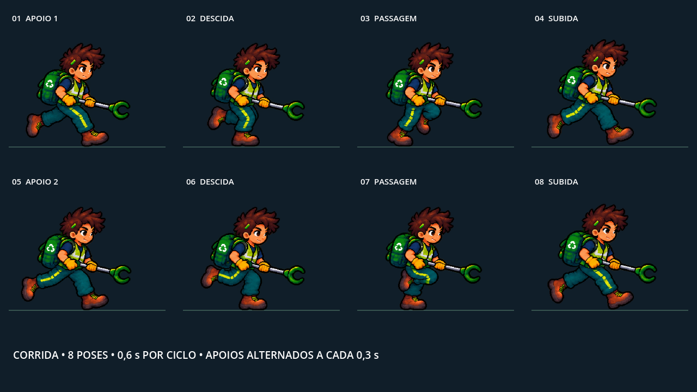

# Ajustes de corrida e rolagem

Atualização de 15/10/2026.

## Corrida

O ciclo anterior continha várias poses consecutivas com a mesma perna à frente. Foi criada uma folha específica para a corrida com a ferramenta integrada ImageGen, preservando o desenho do personagem. Um ajuste adicional corrigiu a pose de descida da segunda perna.

- PNG final: [personagem_corrida_sheet.png](../assets/sprites/personagem_corrida_sheet.png), 1774 × 887, RGBA transparente.
- Prévia renderizada no Godot: [corrida-preview.png](corrida-preview.png).
- `scenes/Player.tscn`: 8 quadros de corrida a 13,333333 fps; ciclo de 0,6 s na velocidade base, com apoios alternados a cada 0,3 s.
- `scripts/Player.gd`: a nova corrida usa escala 0,56 e offset (-320, -464), enquanto as outras ações mantêm escala 0,94 e offset (-160, -264). As duas geometrias foram alinhadas à mesma base dos pés e à mesma altura aparente.
- Margens do atlas alinham a cabeça e preservam o levantamento natural dos pés. A subida foi ajustada para reduzir o balanço vertical.
- A folha anterior continua sendo usada por idle, ataque e morte e pelo retrato da HUD.

### Movimento da parte superior

O tronco agora inclina no ritmo de cada apoio. A cabeça compensa parte da inclinação, os ombros acompanham a passada e a mochila tem um pequeno atraso. A pedido do usuário, o balanço extra da ferramenta foi removido; a região da garra mantém a pose original do atlas. O movimento é aplicado em `scripts/MovimentoSuperior.gd` sobre uma malha do atlas original, mantendo a textura com filtro nearest e sem separar o desenho em partes.

A fase vem diretamente de `frame` e `frame_progress` da corrida, portanto acompanha também os upgrades de velocidade. A região abaixo da cintura mantém as poses originais. Ataque, idle e morte voltam imediatamente ao desenho normal; a malha herda a reação visual e a cor de dano do personagem.

Comparação animada da primeira versão, ainda com o balanço da ferramenta: [antes e depois](corrida-tronco-comparacao.gif).

Verificado no Godot 4.7.2 com OpenGL: corrida, transições para ataque e idle, retorno à corrida, cadência a 1,5×, dano, morte e reinício. A execução com renderização concluiu com `UPPER_MOTION_OK`, sem erros ou avisos no encerramento. A versão Web em `docs/index.*` continua sem reexportação.



## Publicação Web

A versão Web foi reexportada com Godot 4.7.2 em 15/10/2026, incluindo as novas artes, HUD, cenários, projéteis e a corrida com movimento do tronco e sem o efeito extra na garra. Essa exportação substitui a versão anterior mencionada nas verificações acima.

O GitHub Pages publica `docs/` da branch `main` em https://fepsl.github.io/Trash-Go/. O preset Web exclui documentação e verificadores temporários do pacote do jogo.

Para atualizar novamente, execute na raiz do projeto `godot --headless --path . --export-release Web docs/index.html` e envie os arquivos gerados para a branch `main`.

## Rolagem

| Fase | Velocidade anterior | Velocidade atual | Movimento do fundo por 200 px de câmera |
| --- | ---: | ---: | ---: |
| 1 | 0,24 | 0,24 | 48 px |
| 2 | 0,20 | 0,55 | 110 px |
| 3 | 0,18 | 0,50 | 100 px |
| 4 | 0,32 | 0,65 | 130 px |

A camada de piso continua acompanhando o mundo. Os cenários seguem sem lacunas nas repetições.

## Verificação

Conferido no Godot 4.6 com renderização OpenGL: alternância real dos quadros de apoio ao longo de dois ciclos, intervalo de aproximadamente 300 ms entre apoios, ciclo de 0,6 s, geometria e escala nas transições corrida → ataque → corrida → idle, cadência com Velocidade+, morte, reinício, deslocamento medido dos fundos e cobertura da tela no fim das quatro fases. O verificador concluiu com `RUN_SCROLL_OK`, sem erros de script ou avisos de encerramento.

O preset de exportação existente ainda emite um aviso sobre `runnable` ausente ao importar no editor. A versão Web `docs/index.*` não foi reexportada.

## Prompt inicial do ImageGen

```text
Use case: precise-object-edit. Asset type: corrected RUN CYCLE ONLY sprite animation atlas PNG for a 2D Godot pixel-art game. The provided image is a CHARACTER IDENTITY AND STYLE REFERENCE; preserve exactly this tan young recycling hero with dark brown spiky hair and green accent, lime reflective vest over navy shirt, teal cargo trousers with a bright lime stripe on the NEAR leg, brown work boots, green recycling backpack, ochre gloves, and silver trash grabber with green claw. Generate a BRAND NEW technically correct running animation sheet of that SAME character. TRUE crisp pixel art matching the reference, no painterly or smooth 3D rendering. Critical: the old run cycle incorrectly repeats the same forward leg. This new one MUST have anatomically coherent alternating legs, with an equal half-cycle on each leg. Exactly EIGHT complete poses on transparent alpha background in a STRICT FOUR COLUMNS by TWO ROWS regular grid. Wide landscape image 1536x768, each cell 384x384. Every complete character and grabber fully inside its cell with at least 48 pixels transparent padding; standing sprite head-to-boot height about 200px, same scale in every frame. Side three-quarter view FACING RIGHT at fixed camera angle. Read poses left to right on row 1, then left to right on row 2, in chronological order. Keep head, torso, backpack and tool almost steady in x with only tiny 2-4 pixel body bob in y; both hands hold the tool pointed right. Clearly distinguish NEAR leg (front of viewer, bright lime outer stripe) and FAR leg (darker teal, mostly unstriped). ROW 1: Frame 1 CONTACT: NEAR striped leg extended FORWARD to right, boot lands; FAR dark leg extended backward to left at toe-off. Frame 2 DOWN: NEAR leg bears weight and knee bends, FAR foot lifts from rear. Frame 3 PASSING: NEAR foot passes under hips as support, FAR knee swings FORWARD with lifted foot. Frame 4 UP: NEAR leg extends backward behind hips pushing off, FAR leg reaches forward ready to land. ROW 2: Frame 5 OPPOSITE CONTACT: FAR dark leg extended FORWARD to right, boot lands; NEAR striped leg extended backward to left. Frame 6 OPPOSITE DOWN: FAR leg bears weight and knee bends, NEAR foot lifts from rear. Frame 7 OPPOSITE PASSING: FAR foot supports under hips, NEAR striped knee swings FORWARD with lifted foot. Frame 8 OPPOSITE UP: FAR leg extends backward pushing off, NEAR striped leg reaches forward ready to land again into Frame 1. Make every leg phase DISTINCT; no repeated poses. Hands, hair, vest, tool, proportions and details remain consistent. Correct two-leg anatomy, no extra boots, no fused legs, do not mirror the whole character because he must always face RIGHT. Same invisible floor baseline near local y=300 in each cell; preserve natural small airborne lift in UP poses. Genuinely transparent alpha: no colored haze, no floor, no shadows, no scenery, no text, no labels, no numbers, no grid lines, no checkerboard, no watermark. This is a production RUN cycle atlas, not a character showcase.
```

## Correção da sexta pose

```text
Edit this 8-frame pixel-art running spritesheet. Keep the entire sheet IDENTICAL except ONE specific character: the SECOND CHARACTER IN THE BOTTOM ROW, which is frame 6 (row 2, column 2). Do not change the other seven frames, their layout, colors, scale, transparency, or positions. In frame 6 the legs are wrong: it currently repeats the top-row second pose. Correct frame 6 into the OPPOSITE DOWN pose: the FAR leg, which is DARK TEAL WITHOUT A LIME STRIPE, must be the weight-bearing bent leg with its boot PLANTED BELOW AND SLIGHTLY IN FRONT OF THE HIPS TO THE RIGHT. The NEAR leg, which HAS THE BRIGHT LIME STRIPE, must lift BEHIND THE BODY TO THE LEFT with the knee bending and the boot pointing backward up-left. Show the lime stripe on that bent rearward leg, not on the planted forward leg. Character still faces RIGHT, same tool in both hands, same head, vest, arms, backpack. Ensure frame 6 is the opposite leg stance from frame 2. Match frame 5's leg identities and advance that motion into a bent support pose. Exact same canvas, four columns and two rows, transparent alpha background, no text or grid. This is a precise single-cell anatomy correction, not a redesign.
```
