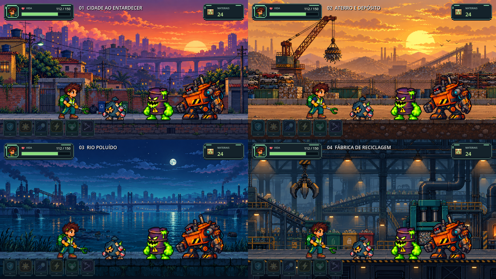

# Backgrounds em pixel art

Atualização de 15/10/2026. Quatro artes novas geradas com a ferramenta integrada ImageGen e salvas no projeto. Todas são PNG RGB opaco, 1672 × 941 pixels. As artes anteriores foram preservadas.



| Fase | Cenário | PNG final |
| --- | --- | --- |
| 1 | Cidade ao entardecer | [fase1_cidade.png](../assets/backgrounds/pixel/fase1_cidade.png) |
| 2 | Aterro e depósito | [fase2_aterro.png](../assets/backgrounds/pixel/fase2_aterro.png) |
| 3 | Rio poluído à noite | [fase3_rio.png](../assets/backgrounds/pixel/fase3_rio.png) |
| 4 | Fábrica de reciclagem | [fase4_fabrica.png](../assets/backgrounds/pixel/fase4_fabrica.png) |

## Integração

`scenes/world/Fase1.tscn` a `Fase4.tscn` usam `scripts/BackgroundFase.gd`. Cada arte é exibida em duas faixas nativas de Sprite2D: o cenário distante rola mais devagar, enquanto o piso acompanha o deslocamento da câmera. A alternância de espelhamento une as bordas dos tiles. O filtro nearest mantém o desenho pixelado.

O recorte do piso e a linha de apoio dos pés foram ajustados por fase. O chão físico, as ondas, os personagens e os limites da câmera não foram alterados.

| Fase | Início do piso na textura | Linha de apoio na textura | Velocidade relativa do fundo |
| --- | ---: | ---: | ---: |
| 1 | 715 | 748 | 0,24 |
| 2 | 700 | 792 | 0,55 |
| 3 | 729 | 772 | 0,50 |
| 4 | 668 | 724 | 0,65 |

`base_visual = 394.0` corresponde à base visual já usada pelos personagens no mundo. A altura e a cobertura são recalculadas quando a câmera ou o viewport mudam. Os PNGs são consumidos diretamente; não há dependências de Python ou ferramentas externas para executar o jogo.

## Verificação

Conferido no Godot 4.6 com renderização OpenGL: carregamento e troca das quatro fases, contato do personagem e dos três inimigos com o chão, alinhamento visual, cobertura horizontal e vertical e repetição do cenário. Por fase foram verificadas as posições de mundo x=100, x=5500, x=9500 e os dois lados de uma emenda de tiles. As quatro fases passaram na conferência completa sem erros de script. A galeria final foi renderizada no próprio Godot.

A configuração de exportação existente ainda avisa sobre a chave `runnable` ausente durante a importação no editor. A exportação Web `docs/index.*` não foi regenerada; execute o projeto no Godot para ver as mudanças.

## Prompts usados no ImageGen

### Cidade ao entardecer

```text
Use case: stylized-concept. Asset type: FINAL panoramic environment background PNG for Trash Go, a 2D pixel-art recycling action game. Create a completely new professionally crafted game background, not a screenshot or a mockup. LANDSCAPE 16:9 composition, desired 2048x1152. TRUE crisp 16-bit pixel art: visible square pixel clusters, hard-edged stepped contours, intentional limited color palette, rich but disciplined details, SNES/modern indie action game environment quality. No smooth digital painting, no antialiasing, no blur, no photographic textures, no 3D. Orthographic SIDE VIEW for a character walking horizontally to the right. Critical production layout: one continuous DEAD STRAIGHT HORIZONTAL WALKABLE GROUND TOP at exactly 85 percent of the image height, perfectly level from left to right, no gaps, no steps, no obstacles on this walking lane. Bottom 15 percent shows the vertical face of this continuous sidewalk/platform and a simple dark lower ground band. Do not put a second path at another height. All decorative objects are BEHIND this lane, never occluding players. Upper 85 percent is the environment. Keep the lower middle region (55 to 84 percent of image height) relatively low contrast and uncluttered so bright characters and enemies read clearly. Strong depth: restrained distant silhouettes, middle-distance landmarks, detailed but subtle nearby scenery. Horizontally repeating environment: left and right edges should meet naturally in a horizontal game loop, similar sky color and ground profile at both sides, no giant clipped landmark at edges. Controlled light, beautiful mood, coherent shapes and shadows. Opaque background, no transparency. NO characters, no people, no enemies, no UI, no health bars, no text, no labels, no watermarks, no frame, no collage, no sprite sheets. Environment: polluted Brazilian-inspired CITY STREET AT SUNSET. Layered indigo and muted violet apartment blocks, terracotta roofs, rooftop water tanks and antennas, warm small amber windows, distant elevated viaduct, dramatic peach-orange clouds fading into plum sky. In the middle distance: brick walls, modest closed shopfronts without signs, power cables, a few old streetlamps with small mint highlights, grouped blue/yellow/red/green recycling bins and restrained bag/can litter near walls, subtle vegetation reclaiming edges. Ground: a straight grey-blue stone sidewalk curb, compact brick vertical face and darker asphalt at bottom. Avoid repeating the old game's exact composition; create a new warm, appealing, atmospheric district. Palette indigo navy, dusty purple, warm apricot sky, small sage green accents. Background behind character feet is muted slate blue.
```

### Aterro e depósito

```text
Use case: stylized-concept. Asset type: FINAL panoramic environment background PNG for Trash Go, a 2D pixel-art recycling action game. Create a completely new professionally crafted game background, not a screenshot or a mockup. LANDSCAPE 16:9 composition, desired 2048x1152. TRUE crisp 16-bit pixel art: visible square pixel clusters, hard-edged stepped contours, intentional limited color palette, rich but disciplined details, SNES/modern indie action game environment quality. No smooth digital painting, no antialiasing, no blur, no photographic textures, no 3D. Orthographic SIDE VIEW for a character walking horizontally to the right. Critical production layout: one continuous DEAD STRAIGHT HORIZONTAL WALKABLE GROUND TOP at exactly 85 percent of the image height, perfectly level from left to right, no gaps, no steps, no obstacles on this walking lane. Bottom 15 percent shows the vertical face of this continuous sidewalk/platform and a simple dark lower ground band. Do not put a second path at another height. All decorative objects are BEHIND this lane, never occluding players. Upper 85 percent is the environment. Keep the lower middle region (55 to 84 percent of image height) relatively low contrast and uncluttered so bright characters and enemies read clearly. Strong depth: restrained distant silhouettes, middle-distance landmarks, detailed but subtle nearby scenery. Horizontally repeating environment: left and right edges should meet naturally in a horizontal game loop, similar sky color and ground profile at both sides, no giant clipped landmark at edges. Controlled light, beautiful mood, coherent shapes and shadows. Opaque background, no transparency. NO characters, no people, no enemies, no UI, no health bars, no text, no labels, no watermarks, no frame, no collage, no sprite sheets. Environment: a RECYCLING SCRAP YARD / LANDFILL IN LATE AFTERNOON. Golden dusty sky with layered muted ochre clouds, distant low factories and hills of sorted discarded material, a few small birds as pixel silhouettes. Middle-distance rusty crane and hanging magnet, wire fencing, orderly stacks of crushed vehicles, compacted cardboard cubes, blue steel drums and green metal containers among scrap mounds. Emphasize readable large forms rather than noisy trash speckles. Industrial but adventurous, strong cinematic depth. Ground: perfectly level compacted earth loading lane with a low continuous retaining curb; bottom band a cross-section of dark packed dirt and small stones. Color palette warm honey and dusty rust, desaturated teal metal, chocolate navy shadows. Keep foreground open for combat, no vehicles, piles or barrels sitting on the playable lane.
```

### Rio poluído à noite

```text
Use case: stylized-concept. Asset type: FINAL panoramic environment background PNG for Trash Go, a 2D pixel-art recycling action game. Create a completely new professionally crafted game background, not a screenshot or a mockup. LANDSCAPE 16:9 composition, desired 2048x1152. TRUE crisp 16-bit pixel art: visible square pixel clusters, hard-edged stepped contours, intentional limited color palette, rich but disciplined details, SNES/modern indie action game environment quality. No smooth digital painting, no antialiasing, no blur, no photographic textures, no 3D. Orthographic SIDE VIEW for a character walking horizontally to the right. Critical production layout: one continuous DEAD STRAIGHT HORIZONTAL WALKABLE GROUND TOP at exactly 85 percent of the image height, perfectly level from left to right, no gaps, no steps, no obstacles on this walking lane. Bottom 15 percent shows the vertical face of this continuous sidewalk/platform and a simple dark lower ground band. Do not put a second path at another height. All decorative objects are BEHIND this lane, never occluding players. Upper 85 percent is the environment. Keep the lower middle region (55 to 84 percent of image height) relatively low contrast and uncluttered so bright characters and enemies read clearly. Strong depth: restrained distant silhouettes, middle-distance landmarks, detailed but subtle nearby scenery. Horizontally repeating environment: left and right edges should meet naturally in a horizontal game loop, similar sky color and ground profile at both sides, no giant clipped landmark at edges. Controlled light, beautiful mood, coherent shapes and shadows. Opaque background, no transparency. NO characters, no people, no enemies, no UI, no health bars, no text, no labels, no watermarks, no frame, no collage, no sprite sheets. Environment: a POLLUTED URBAN RIVER AT BLUE HOUR under a luminous small pale moon and subtle stars. Layered deep blue city and factory silhouettes on the distant bank, a long graceful distant bridge with tiny amber lights, cyan teal water reflections and a few discarded bottles and small oil slicks drifting in the background water. Soft turquoise atmospheric separation, silhouettes of riverbank reeds and drainage pipes, quiet melancholic but beautiful environmental storytelling. The river occupies much of the middle and lower-middle background, remains visible behind the player. Ground: one unbroken straight old stone RIVERSIDE QUAY in front of the water at the exact 85-percent height, no railing blocking characters, no broken platforms or holes; blue-grey paving stones, dark teal masonry vertical face at bottom. Palette midnight navy, muted cyan, sea green, restrained violet and tiny warm amber highlights. Avoid bright water pixels or foreground decorations competing with the character.
```

### Fábrica de reciclagem

```text
Use case: stylized-concept. Asset type: FINAL panoramic environment background PNG for Trash Go, a 2D pixel-art recycling action game. Create a completely new professionally crafted game background, not a screenshot or a mockup. LANDSCAPE 16:9 composition, desired 2048x1152. TRUE crisp 16-bit pixel art: visible square pixel clusters, hard-edged stepped contours, intentional limited color palette, rich but disciplined details, SNES/modern indie action game environment quality. No smooth digital painting, no antialiasing, no blur, no photographic textures, no 3D. Orthographic SIDE VIEW for a character walking horizontally to the right. Critical production layout: one continuous DEAD STRAIGHT HORIZONTAL WALKABLE GROUND TOP at exactly 85 percent of the image height, perfectly level from left to right, no gaps, no steps, no obstacles on this walking lane. Bottom 15 percent shows the vertical face of this continuous sidewalk/platform and a simple dark lower ground band. Do not put a second path at another height. All decorative objects are BEHIND this lane, never occluding players. Upper 85 percent is the environment. Keep the lower middle region (55 to 84 percent of image height) relatively low contrast and uncluttered so bright characters and enemies read clearly. Strong depth: restrained distant silhouettes, middle-distance landmarks, detailed but subtle nearby scenery. Horizontally repeating environment: left and right edges should meet naturally in a horizontal game loop, similar sky color and ground profile at both sides, no giant clipped landmark at edges. Controlled light, beautiful mood, coherent shapes and shadows. Opaque background, no transparency. NO characters, no people, no enemies, no UI, no health bars, no text, no labels, no watermarks, no frame, no collage, no sprite sheets. Environment: INTERIOR OF A LARGE RECYCLING FACTORY, the final stage. High dark steel roof trusses, background catwalks and grated mezzanines, layered ducts and pipes, a few warm hanging industrial lights, distant sorting conveyor belts carrying small abstract recyclable material, a suspended magnetic claw, bulky teal compacting presses and a furnace window with restrained orange light. Small grouped color-coded recycling collection units in the middle distance, yellow-black hazard accents on machine bases, no written signs. Show technological depth, symmetrical structural rhythm but varied equipment. Ground: one straight unbroken reinforced dark steel loading platform at exactly the 85-percent height, thin yellow hazard markings on vertical edge, dark plates and recessed conduits at bottom. Palette desaturated petrol teal, deep navy iron, warm amber and muted copper. Large calm dark areas behind the playable silhouettes, strong rich atmosphere without eye-searing glows.
```
