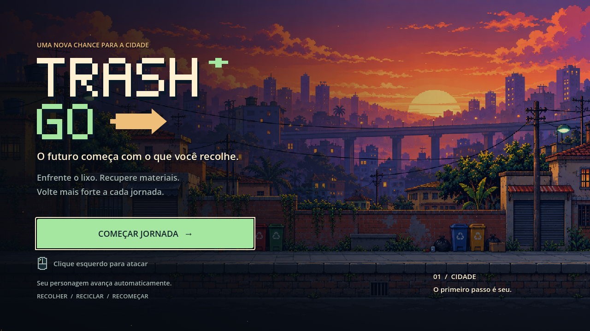
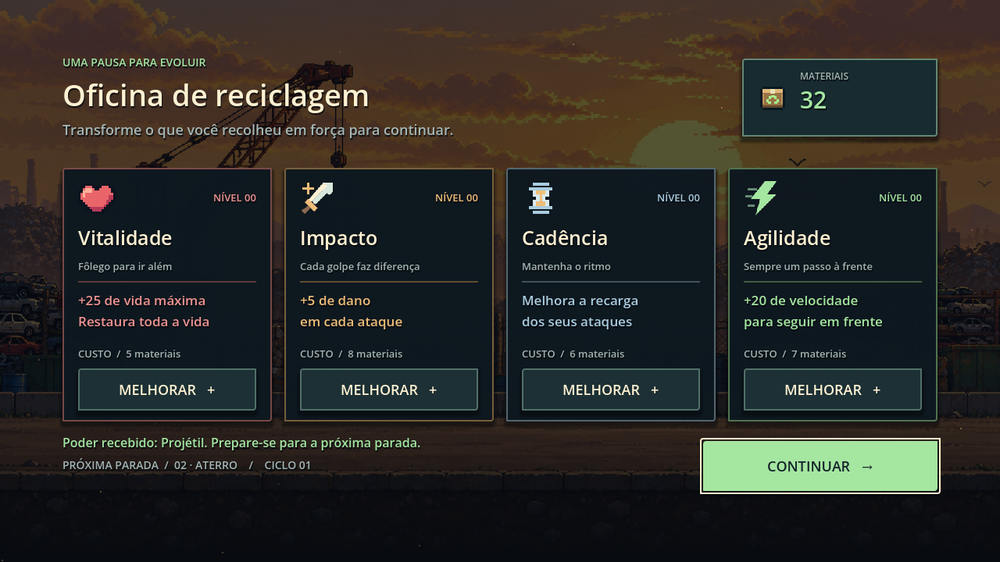

# Menus de entrada e upgrades

Os menus reutilizam os cenários pixel art do jogo e a paleta da HUD: azul escuro, verde claro e âmbar. O logotipo e os ícones novos são SVGs com formas em grade de pixels. A iluminação usa gradientes contínuos e as partículas são pequenos pontos animados. A animação do cenário é interrompida quando a tela está escondida.

## Entrada

O cenário da cidade ao pôr do sol ocupa a tela. Uma sombra lateral mantém a leitura do logotipo e das instruções. O botão de início tem foco para teclado, estados de interação e uma transição curta antes de iniciar a fase. Os controles exibidos correspondem ao jogo atual: avanço automático e ataque com clique esquerdo.

## Oficina

Quatro cartões apresentam Vitalidade (vida), Impacto (dano), Cadência (recarga) e Agilidade (velocidade). Cada cartão mostra nível, benefício, custo e botão de compra. O saldo é atualizado junto com a HUD; sem saldo suficiente, o botão mostra a quantidade faltante e fica desabilitado. A mensagem inferior confirma a compra ou apresenta o poder recebido do chefe. A próxima fase e o ciclo aparecem ao lado do botão de continuar.

O fundo acompanha `GameManager.fase_atual`, que já é avançada antes de abrir a oficina. Os custos, o escalonamento e os efeitos existentes das melhorias foram preservados.

## Edição

- `scripts/MenuEstilo.gd`: paleta, painéis, botões, tipografia e transição de entrada compartilhados.
- `scripts/MenuCenario.gd`: cenários, sombras e partículas; também desenha o fundo no editor.
- `scripts/TelaInicio.gd` e `scripts/TelaUpgrade.gd`: montagem dos controles em tempo de execução e ações de cada tela.
- `scenes/ui/TelaInicio.tscn` e `scenes/ui/TelaUpgrade.tscn`: camadas de interface e cenário.
- `assets/ui/menu/`: logotipo e ícones vetoriais pixelados.

Os controles são construídos pelos scripts. Execute `scenes/Main.tscn` para conferir o layout completo. A composição usa a resolução lógica de 1280 × 720 definida no projeto.

## Verificação

Validado no Godot 4.7.2 com renderização OpenGL em 1280 × 720: abrir o menu inicial, iniciar pelo botão, abrir a oficina, comprar as quatro melhorias, atualizar níveis e custos, sincronizar saldo com a HUD, recusar compras sem materiais, continuar para a próxima fase e retornar à entrada após resetar. As capturas foram inspecionadas para conferir legibilidade e encaixe dos controles.

A exportação Web em `docs/index.html` foi regenerada com `tools/export_web.py`. Os arquivos do jogo usam nomes com hash para atualizar o cache do navegador. Não houve publicação remota.
