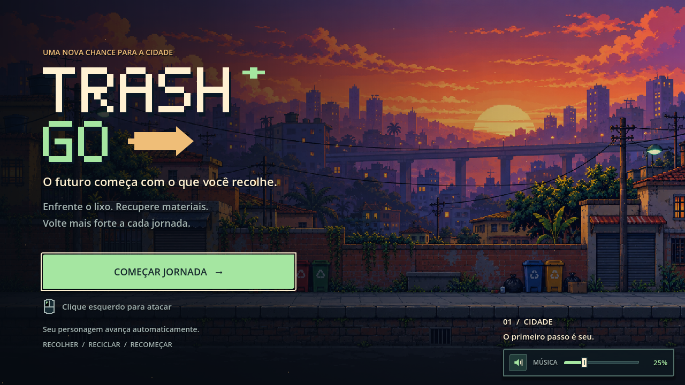

# Música e volume

A playlist fornecida pelo usuário substitui o som ambiente de chuva. A faixa completa tem 5041,818 segundos (84 minutos) e foi convertida de MP3 para Ogg Vorbis estéreo, a 44,1 kHz, com `ffmpeg -c:a libvorbis -q:a 2`. O arquivo original em Downloads foi preservado. A cópia usada pelo jogo é `assets/sounds/musica_lofi.ogg`, com aproximadamente 55 MB, frente aos 148 MB do MP3.

## Comportamento

- A música começa com o jogo e toca em loop.
- A trilha usa `AudioServer.PLAYBACK_TYPE_STREAM` para decodificar aos poucos. O modo padrão Sample da exportação Web tentava expandir os 84 minutos de áudio na memória e causava uma falha de inicialização (`index out of bounds` / `memory access out of bounds`).
- O volume inicial é 25%; o controle permite ajustar de 0 a 100% e silenciar/restaurar sem perder o nível escolhido.
- O painel fica ancorado no canto inferior direito, acima dos menus, disponível na entrada, durante a partida, na oficina e no game over.
- A preferência de volume e silêncio fica salva em `user://audio.cfg`.
- O volume altera apenas a trilha; ataques, dano e botões mantêm seus volumes.
- A música continua ao trocar de fase e recarregar a cena principal.
- Clicar sobre o painel de volume durante a partida não dispara um ataque.

## Arquivos

- `scripts/Musica.gd`: autoload que reproduz a trilha, controla o volume e salva as preferências.
- `scripts/ControleMusica.gd`: controle de volume e botão de silêncio.
- `scenes/ui/ControleMusica.tscn`: painel ancorado no canto inferior direito, na camada 20.
- `scenes/Main.tscn`: inclui o controle de volume.
- `scripts/Main.gd`: não cria mais o player de chuva.
- `scripts/Player.gd`: ignora cliques de ataque sobre controles do grupo `bloqueia_ataque`.
- `assets/ui/menu/musica.svg`, `musica_muda.svg` e `volume_grabber.svg`: ícones pixelados.

## Verificação

Validado no Godot 4.7.2: duração completa, reprodução e loop no final da faixa; ajustes de 0%, 64% e 100%; silêncio e restauração; salvamento do volume; efeitos sonoros preservados; posição e visibilidade do painel; ausência de sobreposição com o botão de continuar; persistência da reprodução e do controle após recarregar a cena. As capturas da entrada, da partida e da oficina foram inspecionadas visualmente.

A exportação Web em `docs/index.html` foi regenerada com `tools/export_web.py`, com nomes de arquivos atualizados por hash.

O erro de memória foi reproduzido no Chromium com a exportação anterior. Após forçar o modo Stream apenas na trilha longa, a nova exportação abriu e iniciou a partida. O teste mediu saída de áudio presente, silêncio ao usar o botão e saída restaurada ao reativar a música; também ajustou o slider e confirmou ausência de erros de script no navegador.
